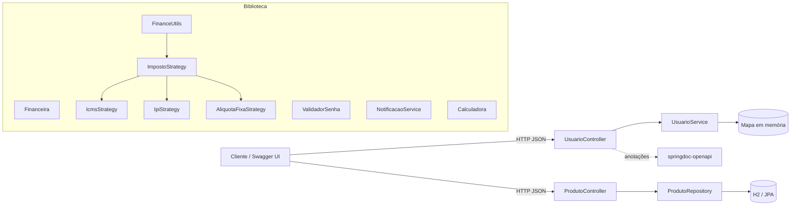
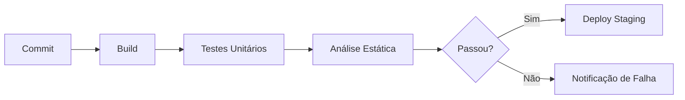
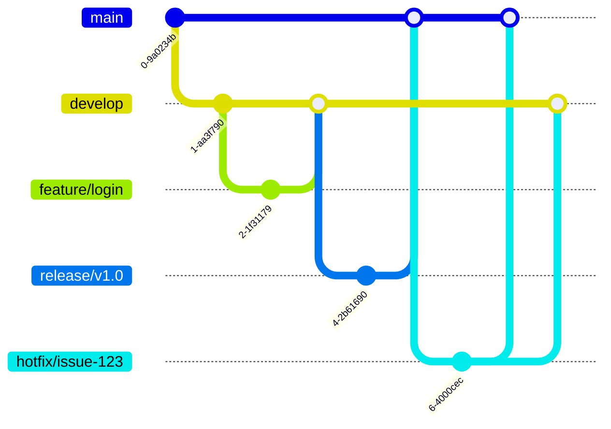

# Arquitetura

## Diagrama de componentes

## Pipeline de qualidade

## Fluxo de branches (Git Flow)

## Principais decisões técnicas

| Data       | Decisão                                   | Razão |
|------------|-------------------------------------------|-------|
| 2026-11-16 | Spring Boot 2.7 + springdoc-openapi 1.7.0 | Versão do springdoc usada na Aula 12 exige `javax.*` (Boot 2.x) |
| 2026-11-16 | Strategy Pattern para impostos            | Reduz a complexidade ciclomática (de 8+ para ≈4, constante) e permite novos impostos sem alterar `FinanceUtils` |
| 2026-11-16 | JaCoCo com mínimo de 85% de linhas        | Gate do desafio da Aula 10 aplicado no `mvn verify` |
| 2026-11-16 | Javadoc com `failOnWarnings`              | Critério do desafio da Aula 12: HTML sem warnings |
| 2026-11-16 | Armazenamento em memória                  | Foco do projeto é qualidade/pipeline, não persistência |
| 2026-11-16 | Perfis Maven `integration-tests` e `security` | Mantêm `mvn test` rápido; CI roda cada perfil em job próprio |
| 2026-11-16 | Monolito com Spring Data JPA + H2 (Aula 13) | MVP simples; H2 em desenvolvimento e TestContainers/PostgreSQL recomendado em CI futuro |
| 2026-11-16 | Manter Spring Boot 2.7 (aula cita 3.x) | springdoc-openapi-ui 1.7.0 (Aula 12) exige `javax.*`; migrar para Boot 3 exige springdoc 2.x |
